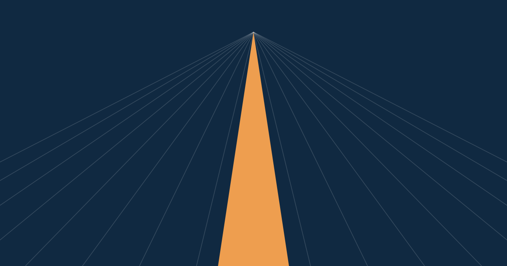
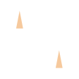

# Kalea brand guide

Kalea's identity is **the street with a hidden crown**: a road between two buildings whose silhouette reads as a three-point crown. This guide tells you which logo file to use, which colors and fonts to apply, and which rules keep the brand recognizable when integrators re-theme the widget.

## Quick path

1. Pick the logo file for your background from [Logo files](#logo-files).
2. Take colors, fonts, and radii from [`tokens.json`](tokens.json). Do not copy hex values by hand.
3. Check text contrast against [Color](#3-color) before shipping.

## 1. The idea

| Element | Meaning |
|---------|---------|
| Name | *Kalea* is Basque for "the street" (*kale* "street" + the article *-a*). |
| Mark | A road running between two buildings: money moving through the city. |
| Hidden crown | The whole silhouette forms a three-point crown: the user's money, treated with respect. |

> **Warning:** Do not use the Hawaiian reading ("joy", "bright"). Hawaiian dictionaries (Pukui-Elbert) define *kalea* as "to choke; whooping cough". Basque is the only origin story.

## 2. Logo

 &nbsp;  &nbsp; 

### Logo files

All files are in [`logo/`](logo/). The wordmark is outlined, so no font is required.

| File | Use on |
|------|--------|
| `kalea-lockup.svg` | White and light neutral backgrounds (default). |
| `kalea-lockup-on-dark.svg` | Ocean, Deep, or dark photos. |
| `kalea-lockup-mono-ink.svg` | One-color print, fax, embossing, and low-fidelity contexts. |
| `kalea-mark.svg` | Light backgrounds where space is tight. |
| `kalea-mark-on-dark.svg` | Dark backgrounds where space is tight. |
| `kalea-mark-mono-ink.svg` / `kalea-mark-mono-white.svg` | One-color contexts and the "Powered by Kalea" footer. |
| `kalea-app-icon.svg` | App stores, home screens, and social avatars (512 × 512). |
| `favicon.svg` | Browser tabs. |

### Clear space and size

| Rule | Value |
|------|-------|
| Clear space | Half the mark height on every side. Nothing else enters this area. |
| Minimum size, mark | 16 px tall. |
| Minimum size, lockup | 80 px wide. |

### Don'ts

- Do not recolor the street. It stays Apricot, except in the mono versions.
- Do not stretch, skew, rotate, or re-space the mark and wordmark.
- Do not add effects: shadows, glows, outlines, gradients, or bevels.
- Do not place the logo on busy areas of patterns or photos.
- Do not make the Kalea logo larger than partner logos on co-branding walls.

## 3. Color

Contrast is the WCAG 2.x ratio against white (`#FFFFFF`). Body text needs at least 4.5:1; large text and UI shapes need at least 3:1.

### Brand and neutrals

| Token | Hex | Role | vs white | Text on white? |
|-------|-----|------|---------:|----------------|
| Ocean | `#1E578F` | Primary: buildings in the mark, primary actions, links | 7.46:1 | Yes |
| Apricot | `#EE9E4F` | Accent: the street, highlights, one icon detail | 2.18:1 | **Never.** Use on Ink or Deep (6.81:1). |
| Violet | `#8F62BC` | Support accent for illustration and charts | 4.52:1 | Yes, barely (just above 4.5:1); prefer Ocean |
| Lime | `#80B946` | Support accent for illustration and charts | 2.35:1 | No |
| Deep | `#102941` | Dark covers and hero backgrounds | 14.84:1 | Yes |
| Ink | `#121A21` | Body text, mono logo | 17.57:1 | Yes |
| Muted | `#67737E` | Secondary text, captions, footer | 4.85:1 | Yes |
| Line | `#D6DBE1` | Borders and dividers | — | No |
| Surface | `#F3F5F7` | Page background behind white panels | — | No |

### Proportion

About **60% neutrals** (White, Surface, Ink), **30% Ocean** (or Deep on dark pages), and **10% accents** (Apricot first, then Violet and Lime). One Apricot moment per view is usually enough.

### Semantic colors

Semantic colors are separate from brand colors on purpose: a failed payment must never look "on brand", and Lime is not "success".

| Token | Hex | vs white | Note |
|-------|-----|---------:|------|
| Success | `#2F7D4F` | 5.04:1 | |
| Warning | `#B7791F` | 3.64:1 | Large text or icons only; pair with an icon. |
| Error | `#C23B32` | 5.30:1 | |
| Info | `#2F6FD6` | 4.81:1 | |

## 4. Typography

All three families are self-hosted through [Fontsource](https://fontsource.org/) packages. No runtime calls to font CDNs.

| Role | Family | Weights | Use for |
|------|--------|---------|---------|
| Display | Funnel Display | 700 | Headlines, hero numbers, the wordmark. |
| Text | Golos Text | 400, 500, 600 | UI labels, buttons, paragraphs. |
| Mono | Sometype Mono | 400, 500 | Data, exchange rates, code, transaction IDs, and eyebrows (uppercase with wide tracking). |

- Use tabular numbers (`font-variant-numeric: tabular-nums`) for amounts and rates so columns align.
- Sizes: see `font.size` in [`tokens.json`](tokens.json) (64 / 48 / 32 / 24 / 18 / 16 / 14, mono 13).

## 5. White-label widget rule

Integrators re-theme the widget with their own colors and fonts. Kalea does not fight that.

- Kalea's only presence inside the widget is the **"Powered by Kalea"** footer.
- The footer uses the mono mark (shapes from `kalea-mark-mono-ink.svg`, inlined with `fill="currentColor"`) in the **host's muted text color**.
- Never force Ocean or Apricot into a re-themed widget.

## 6. Graphic elements

Reference files are in [`elements/`](elements/).

| Element | Purpose |
|---------|---------|
| Street perspective | Lines converging on a vanishing point with the Apricot street. Covers, Open Graph images, hero backgrounds. ([`street-perspective.svg`](elements/street-perspective.svg)) |
| City grid | Thin orthogonal grid that suggests blocks. Quiet background texture. |
| Dusk gradient | Deep to Ocean with a hint of Apricot at the horizon. **The only gradient in the system.** |
| Skyline band | Row of building silhouettes cut from the mark. Section dividers and footers. |
| Crown pattern | Repeating marks on Ocean. Never behind text. ([`crown-pattern-tile.svg`](elements/crown-pattern-tile.svg)) |
| Street plates | Rounded signs reading "&lt;Place&gt; kalea" in mono. Coverage maps and country lists. ([`street-plate.svg`](elements/street-plate.svg)) |
| Building-cut containers | Cards with one chamfered corner (radius token `chamfer`). Feature highlights. |
| Crown-cut image frames | Photos masked with the three-point crown top edge. |
| Lanes | Dashed connectors and underlines that show a flow from step to step. |
| Street highlight | Apricot bar under a key word, like a painted road line. |
| Road-marking arrows | Bold directional arrows for steps and calls to action. |
| Hero number | One large Funnel Display figure (rate, fee, time) with a mono label. |
| Icons | 1.8 px stroke, rounded joins, with exactly one Apricot detail. |

 &nbsp; 

`street-plate.svg` uses live `<text>` as an example only. Production plates are HTML and CSS so they can be translated and stay accessible.

**Motion.** Two reference animations exist: the **street-flow** loop (dashes travelling up the street) and the **crown-reveal** logo animation (buildings rise, then the street draws in). Keep motion subtle and respect `prefers-reduced-motion`.

## 7. Co-branding

| Format | Rule |
|--------|------|
| "Kalea × Partner" lockup | Kalea lockup, a thin "×", then the partner logo. Both logos at the same optical height. |
| "Powered by Kalea" | Partner leads; Kalea follows in mono at the partner's muted color. |
| Partner assets | Use only files from each partner's official press kit. Never redraw or recolor a partner logo. |

## 8. Tokens

[`tokens.json`](tokens.json) is the single source of truth for color, font, and radius values. `apps/web` consumes these tokens; change a value here first, then update the consumers.

## Archive

Earlier explorations live in [`archive/`](archive/). They are superseded and kept for history only.
