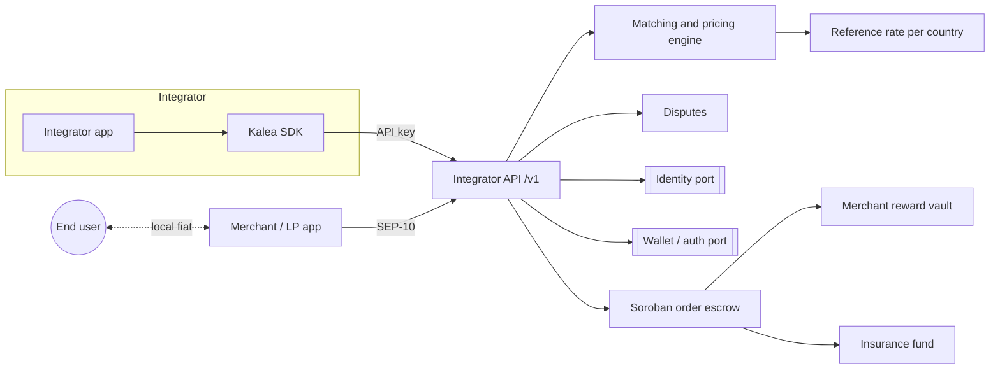

# Architecture

Kalea is an integrator-facing API in front of a matching and pricing engine, with all USDC settlement enforced by a Soroban escrow on Stellar. Local fiat never passes through Kalea.

> Most components below are planned. See the status column and the [README](../README.md#current-status).

## Overview

## Components

| Component | Responsibility | Status |
| --- | --- | --- |
| Integrator API / SDK | Quotes, orders, balance, webhooks. Scoped per integrator | Planned (`/v1`) |
| Matching and pricing engine | Picks a merchant for each order. Prices per country and side over a reference rate: buy = mid + markup, sell = mid - discount | Planned |
| Soroban order escrow | One escrow per order in Stellar USDC. Fixed amounts, configurable timeouts, fee/reward/insurance split on release, refund on timeout | Planned ([contracts](../contracts/README.md)) |
| Merchant reward vault | Holds rewards in 7-day cycles before merchants can withdraw | Planned |
| Insurance fund | Receives ~0.1% per order; covers losses from resolved disputes | Planned |
| Disputes | Freezes the escrow, collects evidence, resolves to release or refund | Planned |
| Identity port | KYC/liveness and social-proof providers behind one interface | Planned |
| Wallet / auth port | Wallet and account provider behind one interface | Planned |
| Prefunded balance ledger | Integrator USDC balances and per-order fee debits | Planned |

## Authentication

| Caller | Method |
| --- | --- |
| Integrators | API keys, scoped to one integrator |
| Merchants / LPs | SEP-10 challenge signed by their Stellar account, exchanged for a JWT |

SEP-10 login already exists in `apps/api` (`GET /auth/challenge`, `POST /auth/token`). In the current code it serves end users; it will move to merchants.

## Ports and adapters

External providers sit behind ports so they can be swapped per country or replaced:

- `IdentityProvider`: KYC, liveness checks, social proofs.
- `WalletProvider`: wallet creation, signing and authentication.
- `RateSource`: market reference rate per country currency.

Concrete providers are out of MVP scope and are not chosen yet.

## Fund boundaries

- **Local fiat**: end user <-> merchant only, through local rails under their own accounts.
- **USDC**: held by the order escrow under its rules, then released to the recipient, the reward vault and the insurance fund, or refunded.
- **Integrator fees**: debited from the integrator's prefunded USDC balance.

The lifecycle that drives these movements is in [order-lifecycle.md](order-lifecycle.md).
