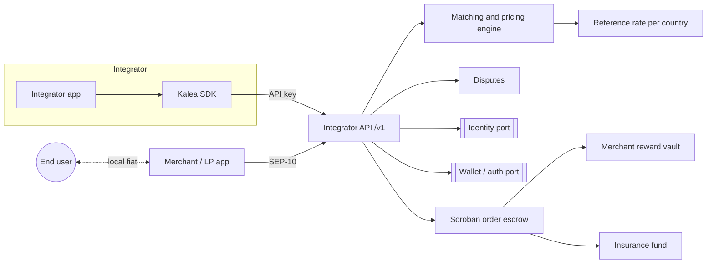

# Architecture

Kalea is an integrator-facing API in front of a matching and pricing engine, with all USDC settlement enforced by a Soroban escrow on Stellar. Local fiat never passes through Kalea.

> Most components below are planned. See the status column and the [README](../README.md#current-status).

## Overview

## Components

| Component | Responsibility | Status |
| --- | --- | --- |
| Integrator API / SDK | Quotes, orders, balance, webhooks. Scoped per integrator | Planned (`/v1`) |
| Matching and pricing engine | Picks a merchant for each order. Prices per country and side over a reference rate: buy = mid + markup, sell = mid - discount | Planned |
| Soroban order escrow (`kalea-escrow`) | One escrow per order in Stellar USDC. Fixed amounts, configurable timeouts, fee/reward/insurance split on release, refund on timeout | Implemented; testnet redeploy pending ([contracts](../contracts/README.md)) |
| Merchant reward vault | Holds rewards in 7-day cycles before merchants can withdraw | Implemented in `contracts/reward-vault`; testnet redeploy pending |
| Insurance fund | Receives ~0.1% per order; covers losses from resolved disputes | Implemented in `contracts/insurance-fund`; testnet redeploy pending |
| Disputes | Freezes the escrow, collects evidence, resolves to release or refund | Contract freeze/resolve implemented; API resolution planned |
| Identity port | KYC/liveness and social-proof providers behind one interface | Planned |
| Wallet / auth port | Wallet and account provider behind one interface | Planned |
| Prefunded balance ledger | Integrator USDC balances and per-order fee debits | Planned |

## P2P B2B Architecture: Stellar vs. EVM Alternatives

Kalea builds B2B fiat <-> USDC clearing infrastructure optimized for **Stellar and Soroban** rather than EVM-based networks.

| Dimension | EVM Solutions | Kalea on Stellar (Soroban) |
| :--- | :--- | :--- |
| **User Onboarding** | Requires Account Abstraction (ERC-4337) and deploying smart contract proxy wallets (EIP-1167) per user. | Native ed25519 accounts (Freighter, mobile wallets); no contract proxy needed. |
| **Fee Sponsorship** | Complex Paymaster contracts burning volatile ETH/gas. | Native Fee-Bump Transactions ([CAP-0015](https://github.com/stellar/stellar-protocol/blob/master/core/cap-0015.md)); relayer wraps transaction and pays XLM base fee. |
| **Settlement Finality** | Probabilistic or L2 batch-submission delays; vulnerable to block reorganizations. | Deterministic 5-second ledger consensus without reorgs; instant clearing certainty. |
| **Token Standard** | ERC-20 with allowance/permit approval steps. | Stellar Asset Contract (SAC / SEP-41) with unified Soroban interop. |
| **Contract Footprint** | Bloated state often storing off-chain metadata on-chain. | Strict off-chain/on-chain boundary; Soroban storage TTL minimized per order. |

## Strict Boundaries: Off-Chain vs. On-Chain

To maintain high throughput, low latency, and minimal gas costs, Kalea enforces a strict division of responsibility:

### Off-Chain (API & Shared Domain)
- **Order Matching & Routing**: Selecting the best-rated merchant with sufficient capacity (`selectMerchant` in `packages/shared/src/domain.ts`).
- **Reputation & Scoring**: Tracking merchant ratings, volume limits, and completion rates.
- **Corridor Pricing Engine**: Fetching live reference market mid-rates and computing spreads, markups, and discounts.
- **Integrator Fee Accounting**: Debiting the Kalea protocol fee directly from the integrator's prefunded USDC balance.
- **Proof & Evidence Collection**: Managing fiat payment receipts, webhooks, and dispute evidence payloads.

### On-Chain (`kalea-escrow`, `kalea-reward-vault`, `kalea-insurance-fund`)
- **Atomic Fund Locking**: Non-custodial lock of Stellar USDC for an order.
- **Enforced Timeouts**: Expiration refunds if fiat is not sent within the payment timeout.
- **State Settlement**: Enforcing terminal states (`Released`, `Cancelled`, `Expired`) and freeze on `Disputed`.
- **Atomic Split on Release**: Distributing USDC in a single transaction to the recipient, the 7-day merchant reward vault (1.5%), and the insurance fund (~0.1%).
- **Reward Vesting**: The reward vault credits each merchant in a per-merchant ledger, vests rewards for 7 days, and lets the arbiter slash unvested rewards.
- **Insurance Payouts**: The insurance fund pays resolved dispute losses up to its balance, with the case reference emitted on-chain.

## Gasless UX: Fee Sponsorship & Pollar Status

- **Protocol Mechanism**: Stellar's native Fee-Bump Transactions (CAP-0015) allow a designated relayer to pay network fees while the user signs with their own key.
- **Pollar (`pollar.xyz`)**: Planned relayer infrastructure to sponsor contract transitions (`lock`, `mark_fiat_sent`, `release`, `cancel`, `expire`) so end users and merchants never need XLM.
- **Current Status**: **Planned / Architectural Design**. Pollar integration is specified for production rollout and is out-of-scope for the foundational MVP codebase (see `odd/tasks/b2b-latam-ramp.md`). The Soroban contract and API signatures are designed to be transparently enveloped by fee-bump relayers without modifying contract business logic.

## Authentication

| Caller | Method |
| --- | --- |
| Integrators | API keys, scoped to one integrator |
| Merchants / LPs | SEP-10 challenge signed by their Stellar account, exchanged for a JWT |

SEP-10 login exists in `apps/api` under `/v1/merchants/auth/*` and already serves merchants; integrators authenticate with API keys.

## Ports and adapters

External providers sit behind ports so they can be swapped per country or replaced:

- `IdentityProvider`: KYC, liveness checks, social proofs.
- `WalletProvider`: wallet creation, signing and authentication.
- `RateSource`: market reference rate per country currency.

Concrete providers are out of MVP scope and are not chosen yet.

## Fund boundaries

- **Local fiat**: end user <-> merchant only, through local rails under their own accounts.
- **USDC**: held by the order escrow under its rules, then released to the recipient, the reward vault and the insurance fund, or refunded.
- **Integrator fees**: debited from the integrator's prefunded USDC balance.

The lifecycle that drives these movements is in [order-lifecycle.md](order-lifecycle.md).
