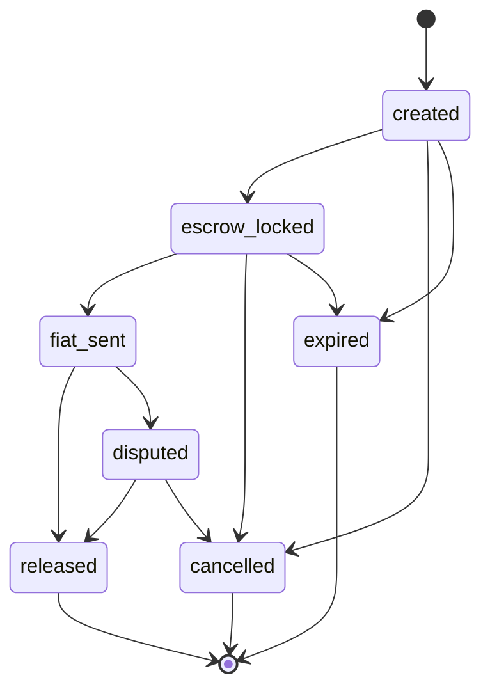

# Order lifecycle

This is the single canonical order lifecycle for docs, shared types, API and web. It is escrow-first: USDC is locked in the order escrow before any fiat is sent.

## Canonical statuses

```ts
type OrderStatus =
  | "created"
  | "escrow_locked"
  | "fiat_sent"
  | "released"
  | "cancelled"
  | "expired"
  | "disputed";
```

| Status | Meaning | Terminal |
| --- | --- | --- |
| `created` | Order created from a quote and matched with a merchant. No funds locked yet | No |
| `escrow_locked` | The USDC provider has locked the fixed amount in the escrow | No |
| `fiat_sent` | The fiat provider has marked the local payment as sent | No |
| `released` | Escrow released USDC to the recipient, reward vault and insurance fund | Yes |
| `cancelled` | Order cancelled; any locked USDC refunded to its depositor | Yes |
| `expired` | A timeout passed; any locked USDC refunded to its depositor | Yes |
| `disputed` | Escrow frozen until a dispute is resolved | No |



## Timeouts (configurable parameters)

| Parameter | Applies in | On expiry |
| --- | --- | --- |
| `lock_timeout` | `created` | `expired`, nothing to refund |
| `payment_timeout` | `escrow_locked` | `expired`, USDC refunded to the depositor |
| `confirmation_timeout` | `fiat_sent` | `disputed` (the escrow is never released or refunded automatically after fiat is marked sent) |

Values are set per country and rail. TODO (open decision): default values.

## Buy (on-ramp: end user pays fiat, receives USDC)

| Transition | Who acts | Fund movement |
| --- | --- | --- |
| -> `created` | Integrator (on behalf of the end user) | None |
| `created` -> `escrow_locked` | Merchant | Merchant locks the fixed USDC amount (end-user amount + reward + insurance) |
| `escrow_locked` -> `fiat_sent` | End user marks paid | End user pays the merchant in local fiat, off-chain |
| `fiat_sent` -> `released` | Merchant confirms receipt | USDC to the end user or integrator destination; reward to the merchant vault; insurance contribution to the fund; Kalea fee debited from the integrator balance |
| `created` / `escrow_locked` -> `cancelled` | End user or integrator, before fiat is sent | Locked USDC refunded to the merchant |
| `created` / `escrow_locked` -> `expired` | Timeout | Locked USDC refunded to the merchant |
| `fiat_sent` -> `disputed` | Either party, or `confirmation_timeout` | Escrow frozen |

## Sell (off-ramp: end user sends USDC, receives fiat)

| Transition | Who acts | Fund movement |
| --- | --- | --- |
| -> `created` | Integrator (on behalf of the end user) | None |
| `created` -> `escrow_locked` | End user | End user locks the fixed USDC amount |
| `escrow_locked` -> `fiat_sent` | Merchant marks paid | Merchant pays the end user in local fiat, off-chain |
| `fiat_sent` -> `released` | End user confirms receipt | USDC to the merchant; reward to the merchant vault; insurance contribution to the fund; Kalea fee debited from the integrator balance |
| `created` / `escrow_locked` -> `cancelled` | Merchant or integrator, before fiat is sent | Locked USDC refunded to the end user |
| `created` / `escrow_locked` -> `expired` | Timeout | Locked USDC refunded to the end user |
| `fiat_sent` -> `disputed` | Either party, or `confirmation_timeout` | Escrow frozen |

### QR payment (sell variant)

A QR payment is a sell order where the merchant pays a third-party local QR code (for example a store or a bill) instead of the end user's own account. It uses the same statuses and fund movements as a sell. The only difference is the fiat destination: the merchant attaches the payment receipt when marking `fiat_sent`, and the end user confirms the payee was paid.

## Disputes

- A dispute resolves to `released` (fiat was paid) or `cancelled` (fiat was not paid; USDC refunded to the depositor).
- The resolution reason and evidence are recorded in the order's event log.
- Losses from a resolved dispute can be covered by the merchant's unvested rewards and then by the insurance fund.
- TODO (open decision): who resolves disputes, and the evidence and response deadlines.

## Rules for every transition

- Amounts are fixed when the order is created and never change afterwards.
- Every transition records the actor, timestamp, evidence and, when on-chain, the Stellar transaction hash.
- Retries are idempotent: repeating a transition returns the same order state.
